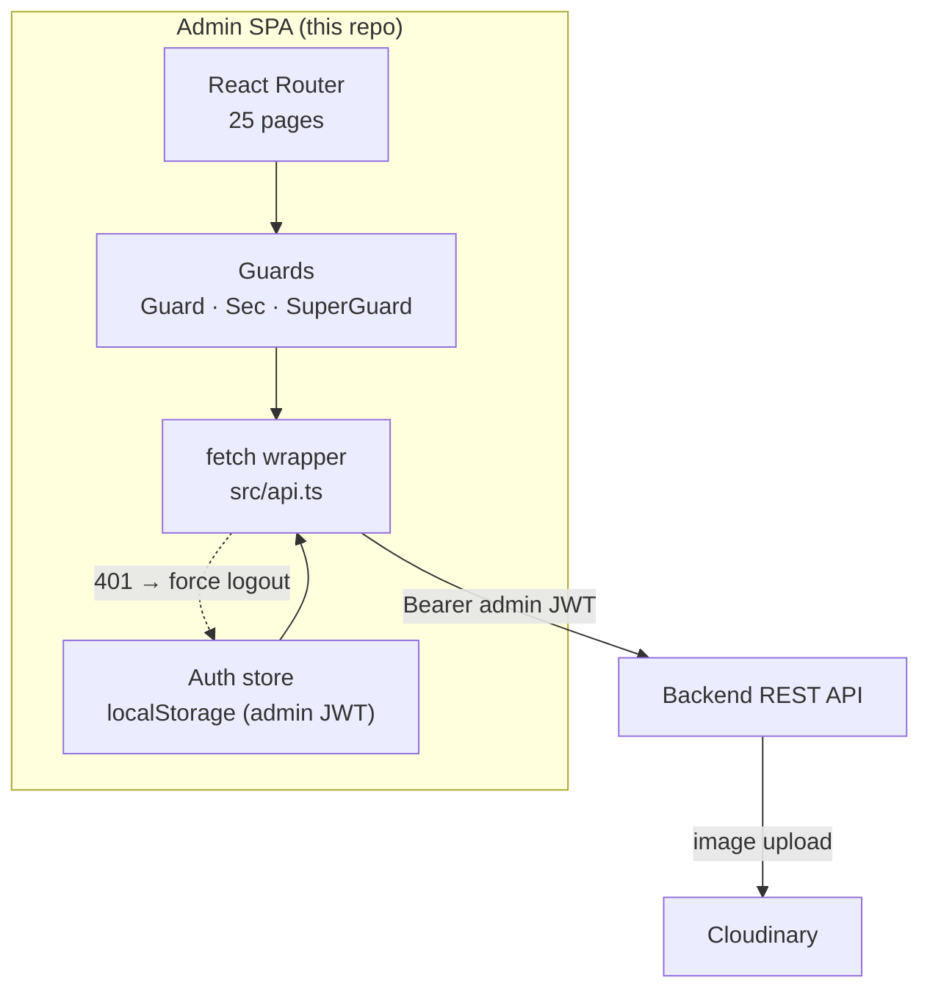
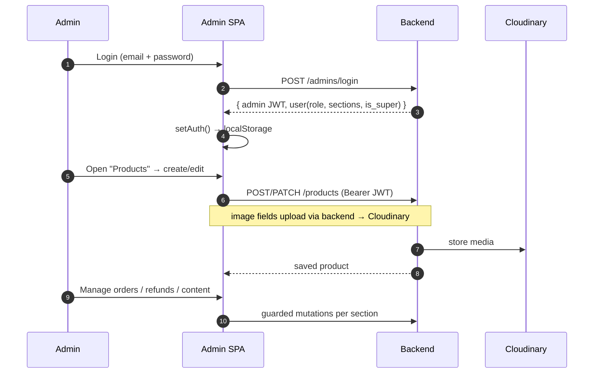
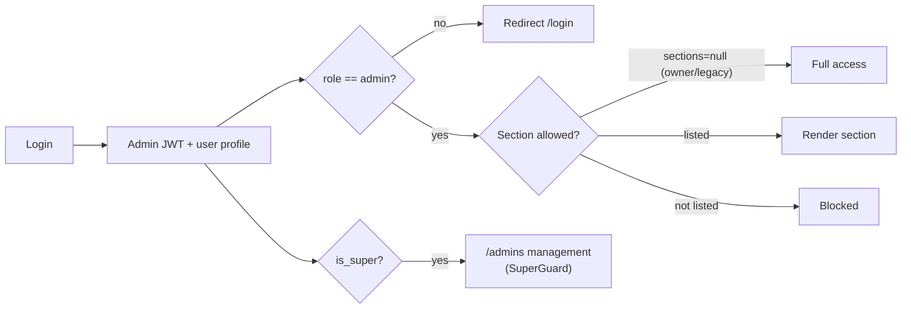

# 🐠 Jharna Aquarium — Admin Panel

> **Internal operations dashboard** for the Jharna Aquarium platform. A lean, fast **React + Vite SPA**
> for managing the catalog, orders, content (CMS/page builder), customers, reviews, coupons and store
> settings — with **role-based section access**.

<p align="left">
  
  
  
  
  
</p>

This repository is **one of three** that make up the Jharna Aquarium platform:

| Repo | Role | Stack |
|------|------|-------|
| [`Jharna-Aquarium-Frontend`](https://github.com/ulmind-com/Jharna-Aquarium-Frontend) | Customer storefront (SSR) | TanStack Start · React · Tailwind |
| **`Jharna-Aquarium-Adminpanel`** ← _this repo_ | Internal admin dashboard | React · Vite · React Router |
| [`Jharna-Aquarium-Backend`](https://github.com/ulmind-com/Jharna-Aquarium-Backend) | REST API + business logic | FastAPI · MongoDB · Motor |

> See [`docs/SYSTEM_ARCHITECTURE.md`](docs/SYSTEM_ARCHITECTURE.md) for how all three repositories communicate.

---

## 📑 Table of Contents

1. [Overview](#-overview)
2. [Tech Stack](#-tech-stack)
3. [Architecture](#-architecture)
4. [Admin Workflow](#-admin-workflow)
5. [Authorization Model](#-authorization-model)
6. [Project Structure](#-project-structure)
7. [Admin Modules](#-admin-modules)
8. [Getting Started](#-getting-started)
9. [Environment Variables](#-environment-variables)
10. [Scripts & Deployment](#-scripts--deployment)

---

## 🔭 Overview

A single-page application that talks to the [backend REST API](https://github.com/ulmind-com/Jharna-Aquarium-Backend)
with a long-lived **admin JWT**. It is intentionally dependency-light (React + React Router only) for
fast builds and simple hosting. Session state lives in `localStorage`; a `401` anywhere forces a clean
re-login. Access to each section is gated by the signed-in admin's **role and allowed sections**.

---

## 🧰 Tech Stack

| Concern | Technology |
|---------|-----------|
| Framework | React 19 (SPA) |
| Build | Vite 8 (`tsc -b && vite build`) |
| Routing | react-router-dom |
| HTTP | native `fetch` wrapper (`src/api.ts`) |
| Auth/session | `localStorage` admin JWT (`src/auth.ts`) |
| Lint | oxlint |
| Language | TypeScript (strict) |

---

## 🏛 Architecture



The `fetch` wrapper injects `Authorization: Bearer <admin_token>` from `localStorage`, parses JSON,
surfaces backend `detail` errors, and on **HTTP 401** clears credentials and redirects to `/login`.

---

## 🔁 Admin Workflow



---

## 🔐 Authorization Model



- **`Guard`** — requires a valid session.
- **`Sec k="…"`** — requires the section key to be in the admin's allowed sections (`null` = unrestricted owner/legacy).
- **`SuperGuard`** — owner/super-admin only (e.g. managing other admins). `is_super` defaults to `true` for legacy sessions, matching the backend owner credential.

---

## 🗂 Project Structure

```
jharnaaquarium admin panel/
├── src/
│   ├── main.tsx            # app bootstrap
│   ├── App.tsx            # routes + guards (Guard/Sec/SuperGuard)
│   ├── api.ts             # fetch wrapper (JWT, 401 handling)
│   ├── auth.ts            # token/user store, role & section helpers
│   ├── config.ts          # API_URL from env
│   ├── sections.ts        # section registry / access keys
│   ├── pages/             # 25 admin screens (see below)
│   ├── components/        # Layout, Guards, DeleteButton, PaymentInfo, ErrorBoundary
│   ├── assets/
│   ├── date.ts  icons.tsx  sfx.ts  styles.css
├── public/
├── docs/                  # engineering docs + diagrams
├── index.html
├── vite.config.ts
├── vercel.json  netlify.toml
└── .env.example
```

---

## 🧩 Admin Modules

25 screens under `src/pages`:

| Group | Pages |
|-------|-------|
| Overview | `Dashboard`, `Analytics` |
| Catalog | `Products`, `ProductEditor`, `Categories`, `Combos` |
| Commerce | `Orders`, `Refunds`, `Returns`, `Coupons`, `Invoice` |
| Content / CMS | `PageBuilder`, `HomeLayout`, `HomeBands`, `Blog`, `Announcements` |
| Services | `GardenServices`, `Stores`, `Waitlist`, `Gifting`(via sections) |
| People | `Users`, `Admins`, `Support`, `Reviews` |
| Config | `Settings` |

---

## 🚀 Getting Started

### Prerequisites
- Node 20+
- A running backend (local or deployed)

### Install & run

```bash
npm install
cp .env.example .env     # set VITE_API_URL
npm run dev              # Vite dev server
```

Point `VITE_API_URL` at your backend (e.g. `http://127.0.0.1:8000`).

---

## 🔑 Environment Variables

**`.env` is git-ignored.** See [`.env.example`](.env.example).

| Variable | Purpose |
|----------|---------|
| `VITE_API_URL` | Backend REST API base URL |

---

## 🛠 Scripts & Deployment

| Script | Action |
|--------|--------|
| `npm run dev` | Dev server |
| `npm run build` | Type-check + production build → `dist/` |
| `npm run preview` | Preview the build |
| `npm run lint` | oxlint |

Static `dist/` deploys to **Vercel** (`vercel.json`) or **Netlify** (`netlify.toml`). Set `VITE_API_URL`
in the hosting dashboard. SPA fallback routes all paths to `index.html`.

---

<sub>Part of the **Jharna Aquarium** platform · Admin panel · React + Vite</sub>
